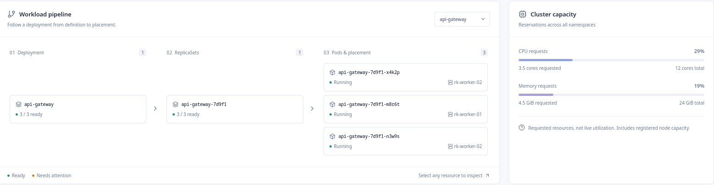
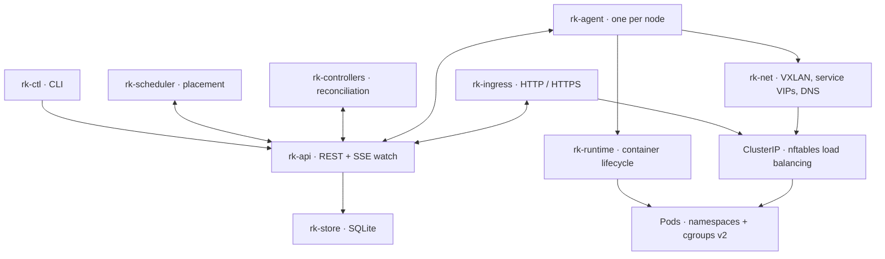

# RustKube

**A Kubernetes-style container orchestration platform built in Rust.**

RustKube takes declarative YAML from image pull to running workload: scheduling,
container isolation, networking, service discovery, ingress, and self-healing.
Its container runtime uses Linux namespaces and cgroups directly, without a
Docker daemon.

[Quickstart](#quickstart) · [Architecture](#architecture) · [Installation](#single-node-installation) · [Documentation](#documentation)

## Features

- **Declarative control plane** — REST API, SSE watches, admission validation,
  optimistic concurrency, and a revisioned SQLite store.
- **Workload orchestration** — resource-aware scheduling, node selectors,
  Deployments, ReplicaSets, scaling, rolling updates, and owner-reference garbage
  collection.
- **Container runtime** — digest-verified OCI image pulls, overlayfs root
  filesystems, Linux namespace isolation, and cgroups v2 resource limits.
- **Cluster networking** — bridge/veth pod networking, a cross-node VXLAN
  overlay, nftables-backed ClusterIP services, and embedded DNS.
- **Workload health** — readiness and liveness probes, restart policies,
  node-failure recovery, and container logs through the CLI.
- **Ingress and access** — host/path routing, TLS termination, API TLS and bearer
  tokens, plus node cordon, drain, and uncordon operations.

RustKube is a reference implementation for exploring container orchestration.
The project specification and implementation notes document its design and scope.

## Quickstart

### Prerequisites

Use Linux with the stable Rust toolchain, a C build toolchain, `pkg-config`,
`make`, and `curl`. The workspace uses Rust edition 2024; rustfmt and Clippy are
configured in [rust-toolchain.toml](rust-toolchain.toml).

The local control plane runs without root. Running containers and cluster
networking requires **root, cgroups v2, overlayfs, and nftables**. Use a dedicated
Ubuntu 24.04 VM for those operations, as described in the
[project specification](SPEC.md).

### Start the local control plane

Run these commands from the repository root:

```sh
make dev-up
export PATH="$PWD/target/debug:$PATH"

rk-ctl apply -f examples/pod.yaml
rk-ctl get pods
rk-ctl describe pod web-0
```

`make dev-up` builds the workspace and starts the API server, scheduler, and
controller manager. The API listens at `http://127.0.0.1:6443`; logs and the
SQLite database live in `.dev/`.

Pods remain pending until a node agent is connected. To run workloads, follow
[single-node installation](#single-node-installation) on your VM.

Watch resource changes, then clean up:

```sh
rk-ctl get pods --watch  # Ctrl+C to stop watching
rk-ctl delete pod web-0
make dev-down
```

### Web console



The read-only [RustKube console](frontend/README.md) visualizes deployments,
ReplicaSets, pods, nodes, and service endpoints. Start with its labeled demo
cluster or connect it to the existing API:

```sh
cd frontend
npm ci
npm run dev                  # http://127.0.0.1:5173
```

Use the console's Connection page and `frontend/.env.local` to configure a live
API. Tokens and trusted CA files stay on the local console server. Deployment
and node operations continue through `rk-ctl`.

## Architecture



The API server is the only component that accesses the store. The scheduler,
controllers, agents, and ingress observe resources through the API; components
that manage resource state write their decisions back through it. Each node
agent manages container lifecycle and programs its local networking.

| Crate | Responsibility |
| --- | --- |
| [`rk-types`](crates/rk-types) | Resource definitions, quantities, shared API client, configuration, and tracing |
| [`rk-store`](crates/rk-store) | Store abstraction, SQLite persistence, revisions, and watch fan-out |
| [`rk-api`](crates/rk-api) | REST API, admission, watches, TLS, and token authentication |
| [`rk-scheduler`](crates/rk-scheduler) | CPU/memory-aware bin packing and node-selector placement |
| [`rk-controllers`](crates/rk-controllers) | Deployment, ReplicaSet, and Node reconciliation; garbage collection; `rk-ingress` binary |
| [`rk-runtime`](crates/rk-runtime) | OCI image handling and container lifecycle; `rkrt` development CLI |
| [`rk-net`](crates/rk-net) | Pod overlay, service virtual IPs, and DNS |
| [`rk-agent`](crates/rk-agent) | Node registration, pod reconciliation, probes, logs, and status reporting |
| [`rk-ctl`](crates/rk-ctl) | Resource management CLI and offline PKI generation |

## Single-node installation

On a dedicated Ubuntu 24.04 VM with the prerequisites installed, build the
release binaries and install the systemd services:

```sh
make release
sudo scripts/install.sh --no-build --api-name 127.0.0.1
sudo systemctl enable --now rustkube.target
```

The installer places binaries in `/usr/local/bin`, configuration and PKI in
`/etc/rustkube`, and cluster data in `/var/lib/rustkube`. The systemd target starts
the API server, scheduler, controllers, node agent, and ingress.

Configure the CLI in a shell with permission to read the generated token:

```sh
export RK_API_URL=https://127.0.0.1:6443
export RK_TOKEN_FILE=/etc/rustkube/pki/token
export RK_CA_FILE=/etc/rustkube/pki/ca.crt

rk-ctl get nodes
rk-ctl apply -f examples/deployment.yaml
rk-ctl get pods
rk-ctl scale deployment web --replicas=5
```

The example Deployment runs three nginx replicas initially. Inspect a pod with
`rk-ctl describe pod <pod-name>` or read its output with
`rk-ctl logs <pod-name>`. Delete the workload with `rk-ctl delete deployment web`;
owner-reference garbage collection removes its ReplicaSets and pods.

## Configuration

The API server, scheduler, controllers, and agent load YAML configuration from
`config/<component>.yaml`. Override the file with `--config <path>` or
`RK_CONFIG=<path>`. See the checked-in [configuration examples](config).

| Setting | Purpose |
| --- | --- |
| `RUST_LOG` | Log verbosity, for example `RUST_LOG=debug make dev-up` |
| `RK_API_URL` | CLI API endpoint; defaults to `http://127.0.0.1:6443` |
| `RK_TOKEN_FILE` | CLI bearer-token file |
| `RK_CA_FILE` | CLI CA certificate used to verify API TLS |

The CLI also accepts `--api-url`, `--token-file`, and `--ca-file`.

Local development defaults to HTTP without authentication. The installer enables
TLS and bearer-token authentication. For manual setup, `rk-ctl pki init --dir pki`
generates the CA, server certificate, and token; configure `authTokenFile` and
`tls.certFile`/`tls.keyFile` on the API, and `tokenFile`/`caFile` on its clients.
The `/healthz` endpoint remains unauthenticated.

## Development and testing

| Command | Purpose |
| --- | --- |
| `make build` | Build all workspace crates |
| `make release` | Build optimized binaries |
| `make fmt-check` | Check Rust formatting |
| `make clippy` | Lint all targets with warnings treated as errors |
| `make test` | Run workspace tests |
| `make e2e` | Run the root-free API smoke test |

The [full cluster test](scripts/e2e-cluster.sh) exercises authenticated API access,
Deployments, service load balancing, TLS ingress, scaling, rolling updates,
self-healing, logs, and node drain. Run it as root on a disposable Ubuntu 24.04 VM;
it creates and cleans up cluster processes, containers, and network state.

## Documentation

The [project specification](SPEC.md) covers the resource model, component
requirements, and target environment. Implementation notes and runnable demos
provide a closer look at each subsystem:

| Topic | Design notes | Demo |
| --- | --- | --- |
| Container runtime | [Runtime](docs/phase-1-notes.md) | [Pull, run, logs, and cleanup](scripts/phase1-demo.sh) |
| API and persistence | [Control plane](docs/phase-2-notes.md) | [API smoke test](scripts/e2e.sh) |
| Node lifecycle | [Agent](docs/phase-3-notes.md) | [Registration and self-healing](scripts/phase3-demo.sh) |
| Scheduling | [Scheduler](docs/phase-4-notes.md) | [Placement across two nodes](scripts/phase4-demo.sh) |
| Workload management | [Controllers](docs/phase-5-notes.md) | [Scaling, rollouts, and recovery](scripts/phase5-demo.sh) |
| Pod networking | [VXLAN overlay](docs/phase-6a-notes.md) | [Cross-node connectivity](scripts/phase6a-demo.sh) |
| Service discovery | [Services and DNS](docs/phase-6b-notes.md) | [VIPs and DNS resolution](scripts/phase6b-demo.sh) |
| Workload health | [Probes and logs](docs/phase-7a-notes.md) | [Readiness and restarts](scripts/phase7a-demo.sh) |
| HTTP routing | [Ingress](docs/phase-7b-notes.md) | [Host routing](scripts/phase7b-demo.sh) |
| API access | [TLS and tokens](docs/phase-8a-notes.md) | [Authenticated control plane](scripts/phase8a-demo.sh) |
| Cluster operations | [Ingress TLS and drain](docs/phase-8b-notes.md) | [TLS termination and node drain](scripts/phase8b-demo.sh) |
| Installation and integration | [Systemd and end-to-end tests](docs/phase-8c-notes.md) | [Full cluster test](scripts/e2e-cluster.sh) |

For an application example, see the [static website demo](scripts/website-demo.sh),
which serves a site through a Deployment, Service, and Ingress.
